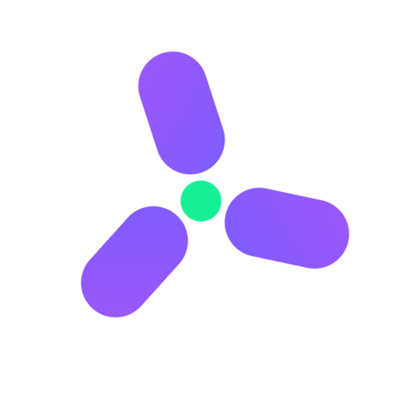

<p align="center">
  
</p>

# solana_kit_test_support

Deterministic fixtures for testing public [`solana_kit_client`] behavior without a
node. Add it as a dev-dependency; it is unpublished and intentionally outside the
SDK runtime graph. It starts no runtime, timer, task, network request or retry.

[`solana_kit_client`]: https://crates.io/crates/solana_kit_client

```rust
use solana_kit_client::{Client, Limits, methods::Balance};
use solana_kit_core::Address;
use solana_kit_test_support::{ScriptStep, ScriptedTransport, canned};

# fn main() {
let address = Address::from_bytes([7; 32]);
let transport =
    ScriptedTransport::new([ScriptStep::success(canned::balance(42, u64::MAX))]);
let client = Client::new(transport.clone(), Limits::default());
let response = futures::executor::block_on(client.call(Balance(address, None))).unwrap();

assert_eq!(response.context.slot, 42);
assert_eq!(response.value, u64::MAX);
let request = &transport.requests()[0];
assert_eq!(request.id, 1);
assert_eq!(request.method, "getBalance");
# }
```

## Scripted exchanges

`ScriptedTransport::new` takes a finite ordered list of `ScriptStep` values:

- `ScriptStep::success` frames exact result JSON with the request's actual ID.
- `ScriptStep::remote_error` and `ScriptStep::remote_error_with_data` frame a
  correlated JSON-RPC error; `data` stays exact JSON.
- `ScriptStep::raw` returns an exact status and body for malformed or deliberately
  uncorrelated response tests.
- `ScriptStep::failure` injects a typed `TransportError`.
- `ScriptStep::pending` returns a `PendingExchange` control with the step.

Every exchange consumes exactly one step and appends one `CapturedRequest` with
the parsed ID, method, exact body bytes and receive budget. Responses are owned by
the exchange; the script never hands one buffer to two calls. When a finite script
is exhausted, the next exchange returns `TransportFailureKind::Unavailable` with
an `UnexpectedRequest` source naming the method, ID and script length. The real
client still performs all of its own status, framing, correlation, budget and
schema validation.

## Pending and cancellation

Poll the real client call once to register a waker through the pending exchange.
`PendingExchange::status` then reports polls, wakes, waker presence, completion,
delivery and cancellation. `wake` notifies the registered waker once.
`complete`, `complete_success` and `complete_remote_error` deliver an owned outcome
and wake the waiter. Dropping the call future before delivery marks the exchange
cancelled, clears its waker and releases any supplied outcome. The fixture never
retains the dropped future. It releases its state mutex before cloning, waking
or dropping caller wakers and before dropping retained error sources; those
callbacks may inspect the fixture.

## Canned results

`canned::balance`, `canned::latest_blockhash`, `canned::account` and
`canned::missing_account` remove repeated envelope/base64 boilerplate for common
reads. They are raw result builders, not a second response-model catalog. Use
`ScriptStep::success` to correlate them.

## Optional deterministic keypair

Enable the `crypto` feature to use `signer::test_keypair`, `signer::keypair` and
`signer::TEST_SEED`. The fixed key is public fixture material and must never hold
real funds. The feature is off by default and reuses the core `Keypair` type, so
the existing `solana_kit_signers` implementations apply when that crate is in the
test graph.

## Boundaries

The crate does not provide an assertion DSL, address/byte/transaction matcher
wrappers, subscription transport fixtures, a node, an HTTP adapter, or a general
RPC response catalog. Ordinary `assert_eq!` against typed client values and exact
captured bytes is the intended style. Local `Rc` call futures and native `Send`
clients are both supported; the transport's shared state is `Send + Sync` on
targets where the client's error type retains those bounds.
